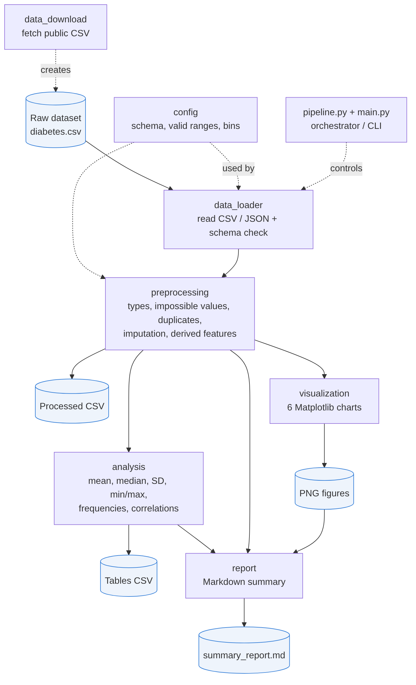

# Health Data Analysis and Reporting System

A modular, tested and reproducible Python application that loads a real public healthcare dataset (Pima Indians Diabetes, 768 patients), cleans it, computes descriptive statistics, draws Matplotlib charts and writes a summary report.

**Course:** Software Development for Data Science | **Topic:** Healthcare and Public Health Data Analysis



## Objectives
1. Read a CSV or JSON dataset with at least 200 records and five attributes.
2. Identify and handle missing values, duplicate records and inconsistent data types.
3. Compute mean, median, standard deviation, minimum, maximum and frequency distributions.
4. Generate at least three Matplotlib charts and save the processed data and charts to an output directory.
5. Apply modular programming, PEP 8, pytest, Git/GitHub and documentation practice.

## Features
| Area | What it does |
|---|---|
| Input | CSV or JSON, schema validation, clear errors for missing files, bad formats and missing columns |
| Cleaning | Text-to-number coercion, impossible-value detection (including zeros recorded as missing), de-duplication, median imputation, audit report |
| Analysis | Summary statistics (on observed values), frequency tables, group summaries, correlation matrix |
| Charts | Outcome bar chart, age histogram, glucose box plot, BMI-vs-glucose scatter, correlation heat map, diabetes rate by age group |
| Output | Cleaned CSV, tables, PNG figures and `summary_report.md` in `output/` |
| Quality | 31 pytest tests, flake8 clean (PEP 8), docstrings on every public function |

## Project structure
```
health-data-analyzer/
├── main.py                     # command-line entry point
├── requirements.txt
├── health_analytics/
│   ├── config.py               # schema, valid ranges, bins
│   ├── data_download.py        # downloads the public dataset
│   ├── data_loader.py          # CSV/JSON input + validation
│   ├── preprocessing.py        # cleaning pipeline
│   ├── analysis.py             # statistics
│   ├── visualization.py        # Matplotlib charts
│   ├── report.py               # Markdown report
│   └── pipeline.py             # orchestration
├── tests/                      # pytest suite
├── notebooks/health_data_analysis.ipynb
├── data/raw/diabetes.csv
├── output/                     # sample generated results
└── docs/                       # design document, test results, diagrams
```

## Installation
Requires **Python 3.10 or newer**.
```bash
git clone <your-repository-url>
cd health-data-analyzer

python -m venv venv
source venv/bin/activate          # Linux / macOS
venv\Scripts\activate             # Windows (Command Prompt)

python -m pip install --upgrade pip
pip install -r requirements.txt
```

## Running the application
```bash
python main.py                    # analyse data/raw/diabetes.csv
python main.py --download         # download the dataset first if missing
python main.py --input my.json --output my_results -v
```

Output:
```
output/
├── processed/cleaned_diabetes_data.csv
├── tables/        summary_statistics.csv, frequency_*.csv, correlation_matrix.csv, diabetes_rate_by_age_group.csv
├── figures/       6 PNG charts
└── reports/summary_report.md
```

## Reproducing the results
```bash
python -m health_analytics.data_download     # re-download the dataset (optional; a copy is in data/raw/)
python main.py
pytest -v
jupyter nbconvert --to notebook --execute --inplace notebooks/health_data_analysis.ipynb
```
The analysis is deterministic: the same input file always gives identical tables, charts and report.

## Testing
```bash
pytest -v
```
31 tests cover valid input, missing values and invalid data in the loader, preprocessing, analysis and the end-to-end pipeline. Results are stored in `docs/test_results/pytest_results.txt`. Check style with `pip install flake8 && flake8 --max-line-length 79 .`

## Jupyter Notebook
```bash
jupyter notebook notebooks/health_data_analysis.ipynb
```

## Dataset and source
**Pima Indians Diabetes Database.** Originally collected by the National Institute of Diabetes and Digestive and Kidney Diseases (NIDDK); 768 women aged 21 or over of Pima Indian heritage, 8 measurements plus a diabetes outcome (1 = diabetic, 0 = not). The CSV in `data/raw/diabetes.csv` was downloaded from `https://raw.githubusercontent.com/plotly/datasets/master/diabetes.csv`. It is also distributed through the UCI Machine Learning Repository.

Citation: Smith, J. W., Everhart, J. E., Dickson, W. C., Knowler, W. C. and Johannes, R. S. (1988). Using the ADAP learning algorithm to forecast the onset of diabetes mellitus. *Proceedings of the Annual Symposium on Computer Application in Medical Care*, 261-265.

Data quality: the file has no blank cells and no duplicates, but it records **missing measurements as zeros** (insulin 374, skin thickness 227, blood pressure 35, BMI 11, glucose 5). The application detects and handles these.

## Data ethics
See [DATA_ETHICS.md](DATA_ETHICS.md).

## Limitations and future work
* **Limitation:** median imputation keeps all patients but understates variability for insulin (48.7% imputed) and skin thickness (29.6%); the sample covers one population and cannot be generalised.
* **Future improvement:** compare imputation methods and add a cross-validated classification model.

## Licence
Code released under the MIT Licence (see `LICENSE`). The dataset keeps its original terms; see the source above.
