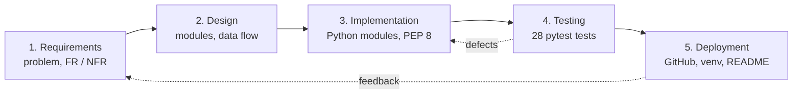
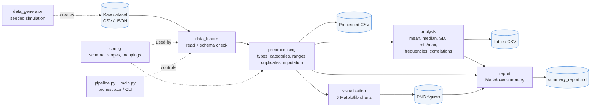

# Software Design Document
**Project:** Health Data Analysis and Reporting System
**Course:** Software Development for Data Science | **Version:** 1.0

---

## 1. Problem statement, objectives and scope

### 1.1 Problem statement
Health records are routinely collected in spreadsheets and exports that contain missing entries, duplicated rows, free-text in numeric fields and inconsistent spellings. Analysts who clean such data by hand produce results that cannot be repeated or audited. Public-health teams need a **repeatable** way to turn a raw extract into trustworthy statistics, charts and a written summary.

### 1.2 Objectives
| ID | Objective | Measure of success |
|---|---|---|
| O1 | Accept a CSV or JSON dataset of at least 200 records and 5 attributes | 600 simulated patients, 13 attributes |
| O2 | Detect and handle missing values, duplicates and inconsistent types | Zero missing cells after cleaning; every action counted |
| O3 | Compute descriptive statistics and frequency distributions | Mean, median, SD, min, max, quartiles, frequencies |
| O4 | Produce at least three meaningful Matplotlib charts | 6 charts |
| O5 | Save the processed data, tables, charts and a report to an output directory | `output/` tree created automatically |
| O6 | Apply sound engineering practice | Modular code, PEP 8, 28 pytest tests, Git history, docs |
| O7 | Be reproducible by a third party | Fixed seed, pinned dependencies, setup instructions |

### 1.3 Scope
**In scope:** loading, validation, cleaning, descriptive (not inferential) analysis, visualisation, report generation, command-line operation, simulated-data generation, automated tests.
**Out of scope:** real-time data feeds, a graphical user interface, predictive modelling, database storage, handling of real identifiable patient data, and any clinical decision support.

---

## 2. Requirements

### 2.1 Functional requirements
| ID | Requirement |
|---|---|
| FR1 | The system shall read a dataset from a CSV or JSON file. |
| FR2 | The system shall reject missing files, unsupported formats, empty files and files lacking required columns with a clear error message. |
| FR3 | The system shall convert text entries in numeric columns to numbers or flag them as missing. |
| FR4 | The system shall standardise inconsistent category spellings (for example `" male "`, `"M"` to `Male`). |
| FR5 | The system shall treat physically impossible values (for example age 250) as missing. |
| FR6 | The system shall identify and remove duplicate patient records. |
| FR7 | The system shall impute remaining missing values (median for numbers, mode for categories) and drop rows lacking patient ID or diagnosis. |
| FR8 | The system shall compute mean, median, standard deviation, minimum, maximum and quartiles for numeric variables. |
| FR9 | The system shall compute frequency distributions (count and percent) for categorical variables. |
| FR10 | The system shall generate at least three charts and save them as PNG files. |
| FR11 | The system shall save the cleaned dataset, statistics tables and a Markdown report to an output directory. |
| FR12 | The system shall provide a command-line interface with input, output and verbosity options. |
| FR13 | The system shall generate a reproducible simulated dataset from a seed. |

### 2.2 Non-functional requirements
| ID | Category | Requirement | How it is met |
|---|---|---|---|
| NFR1 | Reproducibility | Same input and seed give identical results | Seeded `numpy.random.Generator`; tested |
| NFR2 | Maintainability | Code is modular with single-responsibility modules | 8 modules, constants in `config.py` |
| NFR3 | Readability | Complies with PEP 8 and documented with docstrings | `flake8` clean; NumPy-style docstrings |
| NFR4 | Reliability | Invalid input must fail gracefully, never silently corrupt results | Custom `DataLoadError`, validation, 28 tests |
| NFR5 | Performance | Process 600 records in under 10 seconds | Complete run takes about 1-2 s; test suite about 1 s |
| NFR6 | Portability | Runs on Windows, macOS and Linux | `pathlib`, no OS-specific code |
| NFR7 | Usability | Setup in under 5 minutes by following the README | venv + `pip install -r requirements.txt` |
| NFR8 | Accessibility | Charts readable by colour-blind users | Fixed colour-blind-safe palette, direct labels |
| NFR9 | Privacy | No real personal data in the repository | Synthetic data; see `DATA_ETHICS.md` |
| NFR10 | Traceability | Every data change is auditable | Cleaning report counts each action |

---

## 3. Application of the five SDLC stages

The project follows an **iterative waterfall** (Royce, 1970; Sommerville, 2016): the five stages are performed in order, with a feedback loop from testing back to implementation and from deployment back to requirements. This suits a small, well-understood project whose requirements were fixed by the assignment.

| Stage | Activities in this project | Deliverables |
|---|---|---|
| **1. Requirements** | Analysed the brief; chose the healthcare domain; wrote the problem statement, 13 functional and 10 non-functional requirements; decided to simulate data to avoid privacy risk | Section 1-2 of this document |
| **2. Design** | Decomposed the problem into a pipeline of modules following *information hiding* (Parnas, 1972); defined the data schema, valid ranges and cleaning order; chose libraries; designed chart style | Architecture diagram, data dictionary, `config.py` |
| **3. Implementation** | Wrote each module as small, documented, side-effect-free functions that take a DataFrame and return a new one (no in-place mutation); applied PEP 8; developed on a feature branch with incremental commits | `health_analytics/` package, `main.py` |
| **4. Testing** | Wrote 28 pytest unit and integration tests for valid input, missing values and invalid data; ran static analysis with flake8; visually inspected each chart | `tests/`, `docs/test_results/` |
| **5. Deployment** | Pinned dependencies in `requirements.txt`; wrote virtual-environment instructions; documented usage; published to GitHub with `main` as the stable branch | README, GitHub repository |

---

## 4. System architecture and data flow

### 4.1 Components
| Module | Responsibility | Key functions |
|---|---|---|
| `config.py` | Single source of truth for schema, valid ranges, category maps, bin edges | constants |
| `data_generator.py` | Create reproducible simulated data and inject defects | `generate_clean_dataset`, `inject_data_quality_issues`, `generate_dataset` |
| `data_loader.py` | Read CSV/JSON, standardise headers, validate schema | `load_dataset`, `validate_schema` |
| `preprocessing.py` | Clean data and keep an audit trail | `preprocess_dataset` and its eight helper steps |
| `analysis.py` | Statistics and findings | `summary_statistics`, `frequency_distribution`, `correlation_matrix` |
| `visualization.py` | Matplotlib charts | six `plot_*` functions, `generate_all_figures` |
| `report.py` | Markdown report | `build_summary_report`, `save_report` |
| `pipeline.py` / `main.py` | Orchestration and command-line interface | `run_pipeline`, `main` |

### 4.2 Data flow
1. **Input:** `main.py` parses arguments and calls `run_pipeline`.
2. **Load:** `data_loader` reads the file, standardises header names, verifies the 13 required columns.
3. **Clean:** `preprocessing` applies eight ordered steps (below) and returns the clean frame plus an audit report.
4. **Analyse:** `analysis` computes statistics, frequency tables, correlations and findings.
5. **Visualise:** `visualization` draws six charts.
6. **Report:** `report` merges audit, statistics, findings and figures into `summary_report.md`.
7. **Output:** all artefacts are written under `output/`.

### 4.3 Cleaning order and rationale
| Step | Operation | Why this position |
|---|---|---|
| 1 | Coerce numeric columns (strip stray characters, convert) | Types must be correct before range checks |
| 2 | Normalise category spellings | Needed for correct grouping |
| 3 | Parse dates | Invalid dates become `NaT` |
| 4 | Nullify impossible values | Prevents outliers from distorting medians |
| 5 | Remove duplicate patients (by `patient_id`) | Done **before** imputation so duplicates do not bias fill values |
| 6 | Drop rows missing ID or diagnosis | Inventing an outcome would corrupt the analysis |
| 7 | Impute remaining gaps (median / mode) | Median is robust to skew (Little and Rubin, 2019) |
| 8 | Derive features (BMI category, age group, pulse pressure) | Requires complete values |

### 4.4 Design decisions
* **Pure functions.** Each function returns new data instead of changing its input, which makes functions easy to test and reason about.
* **Configuration separated from logic.** Thresholds and mappings live in `config.py`; changing a valid range does not touch the algorithms.
* **Headless plotting.** The `Agg` backend lets the code run on servers and in tests without a display.
* **Fail early with specific errors.** `FileNotFoundError`, `ValueError` and `DataLoadError` carry human-readable messages and `main.py` turns them into exit code 1.

---

## 5. Technical specifications

| Item | Specification |
|---|---|
| Language | Python 3.10 or newer (developed on 3.13) |
| Core libraries | NumPy >= 2.0, pandas >= 2.2, Matplotlib >= 3.9 |
| Testing / quality | pytest >= 8, flake8 |
| Notebook | Jupyter (nbformat, nbconvert, ipykernel) |
| Version control | Git, hosted on GitHub; `main` + feature branches |
| Input format | CSV (UTF-8, header row) or JSON (array of records) |
| Minimum dataset | 200 records, 5 attributes (this project: 600 unique patients, 13 attributes) |
| Interface | Command line: `python main.py [--input] [--output] [--generate-data] [-v]` |

### 5.1 Data dictionary
| Column | Type | Description | Valid range / values |
|---|---|---|---|
| `patient_id` | string | Unique synthetic identifier | `P0001` ... |
| `age` | int | Age in years | 0-110 |
| `gender` | category | Male / Female | |
| `region` | category | North, South, East, West, Central | |
| `smoker` | category | Yes / No | |
| `bmi` | float | Body mass index (kg/m²) | 10-70 |
| `systolic_bp`, `diastolic_bp` | int | Blood pressure (mmHg) | 60-260 / 30-150 |
| `cholesterol` | int | Total cholesterol (mg/dL) | 50-500 |
| `glucose` | int | Fasting glucose (mg/dL) | 30-600 |
| `diagnosis` | category | Healthy, Hypertension, Diabetes, Heart Disease | |
| `annual_visits` | int | Clinic visits per year | 0-60 |
| `visit_date` | date | Date of record | ISO `YYYY-MM-DD` |

Derived: `bmi_category` (WHO cut-offs 18.5 / 25 / 30), `age_group`, `pulse_pressure`.

### 5.2 Expected outputs
`cleaned_patient_data.csv`; `summary_statistics.csv`, six `frequency_*.csv` tables and `correlation_matrix.csv`; six PNG charts; `summary_report.md`; console summary of record counts.

### 5.3 Simulated dataset method
Ages follow a normal distribution clipped to 18-90. BMI, blood pressure, cholesterol and glucose are generated as linear functions of age, BMI and smoking plus Gaussian noise. Diagnosis probabilities follow logistic risk functions of the measurements; annual visits are Poisson with a rate that increases with disease severity. Defects injected: about 5 % blanks in six columns, 15 duplicate rows, text tokens in numeric fields, 7 impossible values and mixed-case/abbreviated categories.

---

## 6. Testing strategy (summary)
| Level | Tool | Coverage |
|---|---|---|
| Static analysis | flake8 (PEP 8) | all `.py` files |
| Unit | pytest | loader, each preprocessing step, each statistic |
| Integration | pytest | full pipeline produces cleaned CSV, tables, charts, report |
| Reproducibility | pytest | identical data for identical seed |
| Visual | manual | every chart inspected for overlap, labelling and accuracy |

---

## References
* Harris, C. R. et al. (2020). Array programming with NumPy. *Nature*, 585, 357-362.
* Hunter, J. D. (2007). Matplotlib: A 2D graphics environment. *Computing in Science & Engineering*, 9(3), 90-95.
* Little, R. J. A. and Rubin, D. B. (2019). *Statistical Analysis with Missing Data* (3rd ed.). Wiley.
* McKinney, W. (2010). Data structures for statistical computing in Python. *Proceedings of the 9th Python in Science Conference*, 56-61.
* Parnas, D. L. (1972). On the criteria to be used in decomposing systems into modules. *Communications of the ACM*, 15(12), 1053-1058.
* Royce, W. W. (1970). Managing the development of large software systems. *Proceedings of IEEE WESCON*, 328-338.
* Sandve, G. K., Nekrutenko, A., Taylor, J. and Hovig, E. (2013). Ten simple rules for reproducible computational research. *PLoS Computational Biology*, 9(10), e1003285.
* Sommerville, I. (2016). *Software Engineering* (10th ed.). Pearson.
* Tukey, J. W. (1977). *Exploratory Data Analysis*. Addison-Wesley.
* van Rossum, G., Warsaw, B. and Coghlan, A. (2001). PEP 8 - Style Guide for Python Code. https://peps.python.org/pep-0008/
* Wilkinson, M. D. et al. (2016). The FAIR Guiding Principles for scientific data management and stewardship. *Scientific Data*, 3, 160018.
* Wilson, G. et al. (2014). Best practices for scientific computing. *PLoS Biology*, 12(1), e1001745.
* World Health Organization (2000). *Obesity: Preventing and Managing the Global Epidemic*. WHO Technical Report Series 894.
* U.S. Department of Health and Human Services. De-identification of protected health information, 45 CFR 164.514(b).
* Government of India (2023). The Digital Personal Data Protection Act, 2023.
