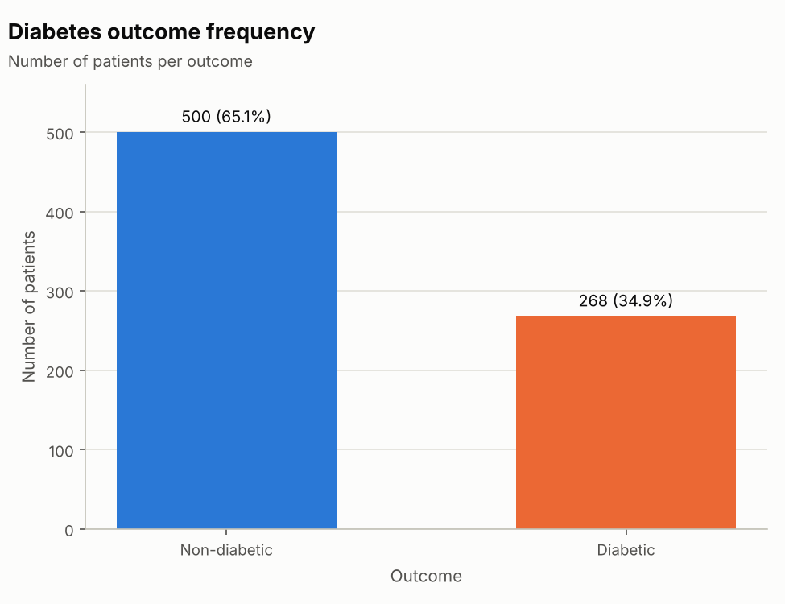
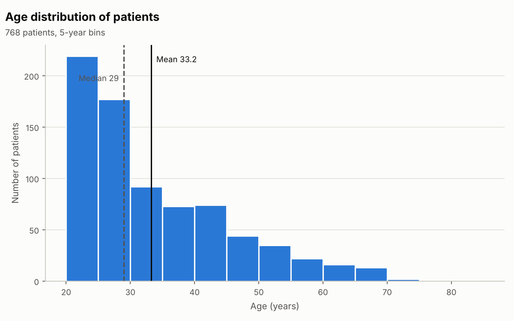
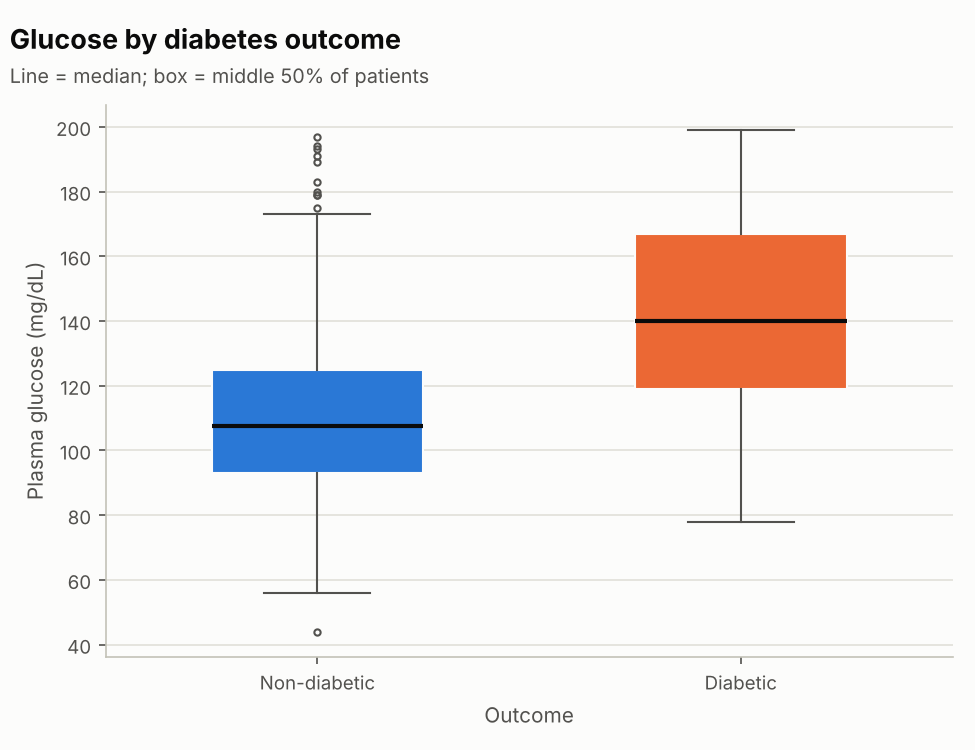
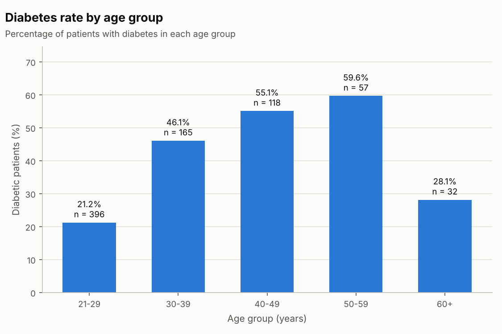

# Health Data Analysis - Summary Report

*Generated 2026-11-20 from `diabetes.csv`*

## 1. Dataset overview

- Raw records: **768** (0 exact duplicates)
- Attributes: **9**
- Missing cells before cleaning: **0**
- Clean records after processing: **768**
- Missing cells after cleaning: **0**

## 2. Data-quality actions

| Action | Count |
|---|---|
| Duplicate records removed | 0 |
| Non-numeric entries converted to missing | 0 |
| Impossible values (incl. zeros recorded as missing) nullified | 653 |
| Rows dropped for missing outcome label | 0 |
| Missing values imputed (column median) | 653 |

**Values imputed per column**

| Column | Imputed | Share of records |
|---|---|---|
| glucose | 5 | 0.7% |
| blood pressure | 36 | 4.7% |
| skin thickness | 227 | 29.6% |
| insulin | 374 | 48.7% |
| bmi | 11 | 1.4% |

## 3. Descriptive statistics

Computed from observed values only (imputed values excluded), so `count` shows how many real measurements each variable has.

| variable | count | mean | median | std | min | q1 | q3 | max |
|---|---|---|---|---|---|---|---|---|
| pregnancies | 768 | 3.85 | 3 | 3.37 | 0 | 1 | 6 | 17 |
| glucose | 763 | 121.69 | 117 | 30.54 | 44 | 99 | 141 | 199 |
| blood_pressure | 732 | 72.47 | 72 | 12.26 | 30 | 64 | 80 | 122 |
| skin_thickness | 541 | 29.15 | 29 | 10.48 | 7 | 22 | 36 | 99 |
| insulin | 394 | 155.55 | 125 | 118.78 | 14 | 76.25 | 190 | 846 |
| bmi | 757 | 32.46 | 32.3 | 6.92 | 18.2 | 27.5 | 36.6 | 67.1 |
| diabetes_pedigree_function | 768 | 0.47 | 0.37 | 0.33 | 0.08 | 0.24 | 0.63 | 2.42 |
| age | 768 | 33.24 | 29 | 11.76 | 21 | 24 | 41 | 81 |

## 4. Frequency distributions

**Outcome Label**

| outcome_label | count | percent |
|---|---|---|
| Non-diabetic | 500 | 65.1 |
| Diabetic | 268 | 34.9 |

**Age Group**

| age_group | count | percent |
|---|---|---|
| 21-29 | 396 | 51.56 |
| 30-39 | 165 | 21.48 |
| 40-49 | 118 | 15.36 |
| 50-59 | 57 | 7.42 |
| 60+ | 32 | 4.17 |

**Bmi Category**

| bmi_category | count | percent |
|---|---|---|
| Obese | 476 | 61.98 |
| Overweight | 180 | 23.44 |
| Normal | 108 | 14.06 |
| Underweight | 4 | 0.52 |

## 5. Key findings

- The dataset holds 768 patients with a mean age of 33.2 years; 268 (34.9%) have diabetes.
- Diabetic patients have a mean glucose of 142.1 mg/dL versus 110.7 for non-diabetic patients.
- Mean BMI is 35.4 for diabetic and 30.9 for non-diabetic patients.
- The diabetes rate is highest in age group '50-59' (59.6%) and lowest in '21-29' (21.2%).
- Glucose has the strongest correlation with diabetes status (r = 0.49); the weakest of all measurements is blood pressure (r = 0.16).
- 62.0% of patients fall in the Obese BMI band.

## 6. Figures

**Outcome Frequency**

**Age Distribution**

**Glucose By Outcome**

**Bmi Vs Glucose**

**Correlation Heatmap**

**Diabetes Rate By Age**

## 7. Notes and limitations

- Findings describe this sample (women of Pima Indian heritage, aged 21+) and must not be generalised to other populations.
- Median imputation preserves sample size but understates variability, especially for insulin and skin thickness where a large share of values was missing.
- Correlation does not imply causation.
