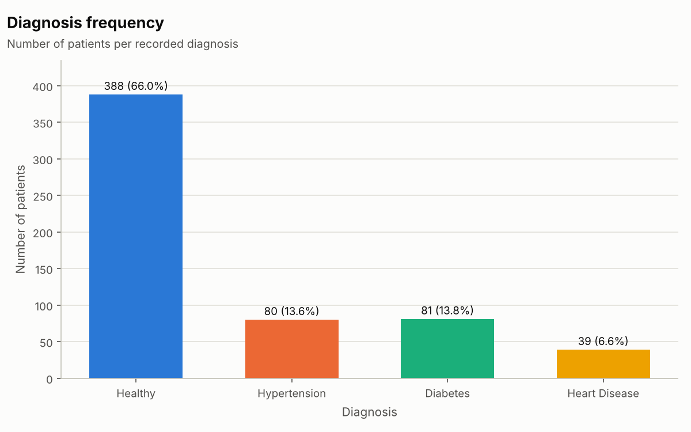
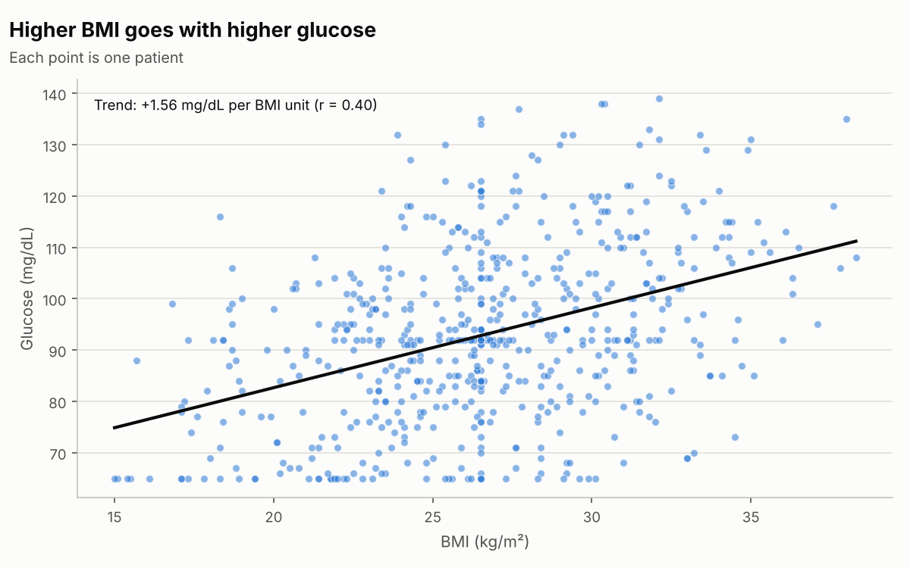
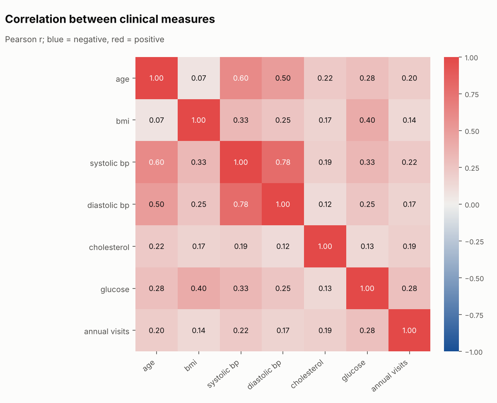
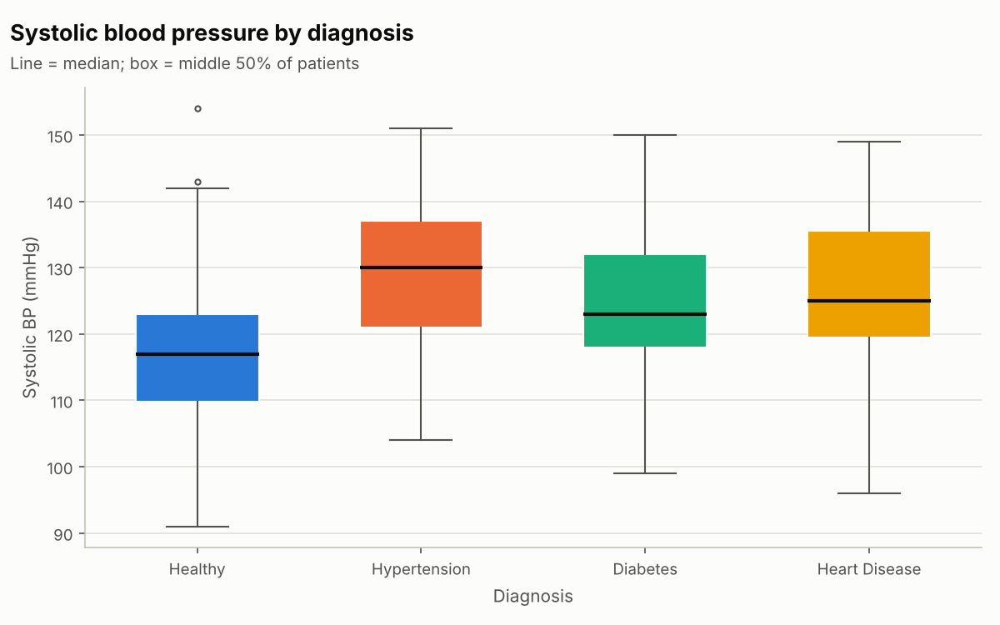
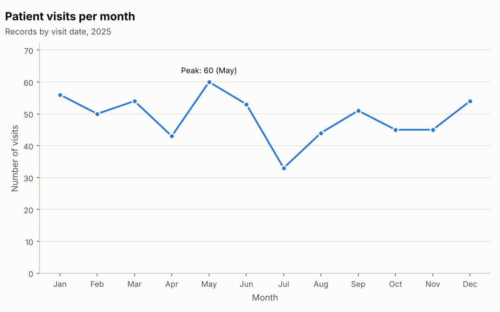

# Health Data Analysis - Summary Report

*Generated 2026-11-20 from `patient_records.csv`*

## 1. Dataset overview

- Raw records: **615** (15 exact duplicates)
- Attributes: **13**
- Missing cells before cleaning: **200**
- Clean records after processing: **588**
- Missing cells after cleaning: **0**

## 2. Data-quality actions

| Action | Count |
|---|---|
| Exact duplicate patient records removed | 15 |
| Text entries in numeric columns converted to missing | 16 |
| Impossible values (outside plausible range) nullified | 7 |
| Unrecognised category labels set to missing | 0 |
| Rows dropped for missing patient ID / diagnosis | 12 |
| Missing values imputed (median / mode) | 201 |

## 3. Descriptive statistics

| variable | count | mean | median | std | min | q1 | q3 | max |
|---|---|---|---|---|---|---|---|---|
| age | 588 | 47.82 | 48 | 15.1 | 18 | 37 | 57 | 90 |
| bmi | 588 | 26.6 | 26.5 | 4.43 | 15 | 23.6 | 29.7 | 38.3 |
| systolic_bp | 588 | 120.1 | 120 | 11.64 | 91 | 111 | 127 | 154 |
| diastolic_bp | 588 | 73.95 | 74 | 8.25 | 55 | 68 | 80 | 95 |
| cholesterol | 588 | 192.7 | 193 | 31.01 | 120 | 172 | 212 | 299 |
| glucose | 588 | 92.95 | 92 | 17.1 | 65 | 80 | 104 | 139 |
| annual_visits | 588 | 1.82 | 1 | 1.86 | 0 | 0 | 3 | 13 |

## 4. Frequency distributions

**Diagnosis**

| diagnosis | count | percent |
|---|---|---|
| Healthy | 388 | 65.99 |
| Diabetes | 81 | 13.78 |
| Hypertension | 80 | 13.61 |
| Heart Disease | 39 | 6.63 |

**Gender**

| gender | count | percent |
|---|---|---|
| Female | 313 | 53.23 |
| Male | 275 | 46.77 |

**Smoker**

| smoker | count | percent |
|---|---|---|
| No | 454 | 77.21 |
| Yes | 134 | 22.79 |

**Region**

| region | count | percent |
|---|---|---|
| North | 127 | 21.6 |
| West | 122 | 20.75 |
| Central | 119 | 20.24 |
| South | 112 | 19.05 |
| East | 108 | 18.37 |

**Bmi Category**

| bmi_category | count | percent |
|---|---|---|
| Overweight | 243 | 41.33 |
| Normal | 179 | 30.44 |
| Obese | 140 | 23.81 |
| Underweight | 26 | 4.42 |

**Age Group**

| age_group | count | percent |
|---|---|---|
| 45-59 | 222 | 37.76 |
| 30-44 | 169 | 28.74 |
| 60-74 | 97 | 16.5 |
| 18-29 | 73 | 12.41 |
| 75+ | 27 | 4.59 |

## 5. Key findings

- The cleaned dataset holds 588 unique patients with a mean age of 47.8 years (median 48).
- 'Healthy' is the most frequent diagnosis (66.0% of patients).
- Smokers average +8.6 mg/dL cholesterol relative to non-smokers (199.3 vs 190.7).
- BMI and glucose are positively correlated (r = 0.40); age and systolic blood pressure show r = 0.60.
- Annual visits are highest for 'Heart Disease' (4.82 per year) and lowest for 'Healthy' (1.04).
- 23.8% of patients fall in the Obese BMI band.

## 6. Figures

**Age Distribution**

**Diagnosis Frequency**

**Bmi Vs Glucose**

**Correlation Heatmap**

**Bp By Diagnosis**

**Monthly Visits**

## 7. Notes and limitations

- The data are simulated; findings illustrate the method and do not describe any real population.
- Median/mode imputation preserves sample size but understates variability.
